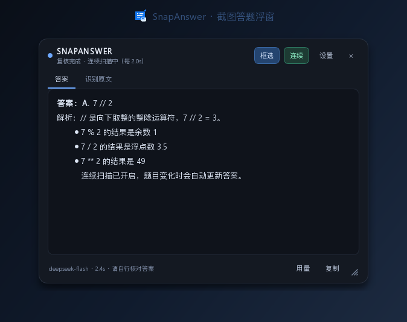
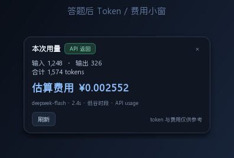
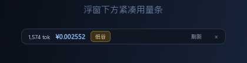

# SnapAnswer

[](https://github.com/Mu-Jiji/snapanswer/actions/workflows/ci.yml)
[](LICENSE)

**框选屏幕题目 → 本地 OCR → AI 作答 → 置顶浮窗显示答案。**

SnapAnswer 是一个面向 Windows 的桌面小工具：按下快捷键拖拽框选题目区域，程序在本地用
RapidOCR 识别中英文，再把识别文本发送到你配置的云端 API 或本地大模型，答案会以置顶浮窗
的形式显示，不打断当前窗口。

支持**手动逐题框选**，也支持**连续扫描**：锁定一个区域后，题目变化时自动重新识别和作答。



> 截图为离屏渲染的界面示意，实际效果以本机运行为准。

## 功能

- **手动框选**：全局快捷键呼出半透明遮罩，拖拽框选，松开即识别。
- **连续扫描**：框选一次后锁定区域，每 2 秒检查；只有 OCR 文本明显变化且连续两次稳定时才请求模型，避免重复消耗额度。
- **答题后自动复核**：每次答案生成后，等待片刻重新截图并 OCR 同一区域；如果新文本与上次题目有实质差异，会自动把新文本再次交给模型作答。
- **本地 OCR**：RapidOCR（ONNX Runtime）离线识别，中文/英文混排，无需 Tesseract。
- **任意 OpenAI 兼容模型**：DeepSeek、OpenAI、硅基流动、OpenRouter、Ollama、LM Studio、vLLM、One API 等。
- **流式回答**：模型边生成边显示；可关闭流式。
- **置顶浮窗**：深色半透明卡片，可拖动、缩放、复制、切换「答案 / 识别原文」。
- **高亮框选区域**：可选地在锁定区域外沿显示鼠标可穿透的高亮边框，确认连续扫描范围。
- **可调浮窗大小**：拖动右下角斜纹手柄，或在设置中填写默认宽高。
- **Token / 费用小窗**：在浮窗左下角外侧显示本次输入/输出/合计 token、耗时和估算费用；支持刷新，并在服务端未返回 usage 时自动估算。
- **高低峰分时单价**：可设置高峰时段和低谷单价，费用按答题时的本地时间自动选择对应单价。
- **系统托盘 + 全局热键**：关闭浮窗后继续驻留托盘。
- **隐私友好**：截图和 OCR 都在本机完成，只把识别出的文字发送给模型；不保存截图。
- **可配置**：模型、温度、超时、OCR 置信度、连续扫描间隔、快捷键等。



## 系统要求

- Windows 10 / 11（主目标平台）
- Python **3.10 – 3.12**（推荐 3.12；暂不建议 3.13/3.14，ONNX Runtime 轮子可能尚未覆盖）
- 可访问模型 API 的网络；本地模型则不需要外网

Linux/macOS 理论上可运行（PyQt6 + RapidOCR + pynput），但截图与全局热键仅在部分桌面环境可用，未做主要适配。

## 快速开始

### 方式一：一键脚本（Windows）

```powershell
git clone https://github.com/Mu-Jiji/snapanswer.git
cd snapanswer
.\run.bat
```

`run.bat` 会调用 `bootstrap.ps1`，依次完成：

1. 定位脚本目录；
2. 查找 Python 3.10–3.12（`py` → `PATH` → 常见安装目录）；
3. 找不到时尝试用 `winget` 安装 Python 3.12（无 winget 则打开官方下载页）；
4. 创建/复用 `.venv`；
5. 检查并安装依赖；
6. 运行 `python -m snapanswer --check` 自检，通过后启动。

脚本使用 Python 的绝对路径，**不要求 Python 已加入 PATH**。只想检查环境而不启动 GUI：

```powershell
.\run.bat -CheckOnly
```

自动安装 Python 需要网络和 winget；安装失败时脚本会给出提示，不会修改系统 PATH。
流程可行性与修正说明见 [`docs/startup-flow.md`](docs/startup-flow.md)。

### 方式二：手动安装

```powershell
git clone https://github.com/Mu-Jiji/snapanswer.git
cd snapanswer

py -3.12 -m venv .venv
.\.venv\Scripts\Activate.ps1
python -m pip install -U pip
python -m pip install -e .

python -m snapanswer
```

也可以只按 requirements 安装运行时依赖：

```powershell
python -m pip install -r requirements.txt
python -m snapanswer
```

开发/测试依赖：

```powershell
python -m pip install -r requirements-dev.txt
```

如果 PowerShell 禁止执行激活脚本，可以直接使用：

```powershell
.\.venv\Scripts\python.exe -m snapanswer
```

安装成命令后也可以直接运行：

```powershell
snapanswer
```

## 配置模型

首次启动没有检测到 API Key 时会自动打开设置。也可以右键托盘图标 →「设置…」，或按
`Ctrl+Alt+S` 显示浮窗后点「设置」。

### 云端 API（DeepSeek 示例）

| 项目 | 值 |
| --- | --- |
| 服务预设 | DeepSeek 官方 API |
| Base URL | `https://api.deepseek.com/v1` |
| 模型 | `deepseek-flash` |
| API Key | 你的密钥，或设置环境变量 `DEEPSEEK_API_KEY` |

推荐用环境变量，避免密钥写进配置文件：

```powershell
setx DEEPSEEK_API_KEY "sk-..."
```

设置后需要重新启动 SnapAnswer（或重新打开终端）。

### 本地模型（Ollama 示例）

```powershell
ollama serve
ollama pull qwen2.5:7b
```

在设置里选择「本地 Ollama」：

- Base URL：`http://127.0.0.1:11434/v1`
- 模型：`qwen2.5:7b`
- API Key：留空

LM Studio、vLLM、One API 等同理：填 OpenAI 兼容的 `/v1` 地址和模型名即可，本地/内网地址
允许不填 Key。

### 配置文件

优先级从高到低：

1. `--config <路径>`
2. 环境变量 `SNAPANSWER_CONFIG`
3. 仓库根目录的 `config.toml`（适合从源码运行）
4. 用户配置目录：
   - Windows：`%APPDATA%\SnapAnswer\config.toml`
   - Linux/macOS：`~/.config/snapanswer/config.toml`
   - 如果上述目录不可写，会自动回退到系统临时目录下的 `snapanswer-data/config.toml`

示例见 [`config.example.toml`](config.example.toml)。**不要提交真实密钥**；仓库根目录的
`config.toml` 已被 `.gitignore` 忽略。

可用环境变量：

| 变量 | 作用 |
| --- | --- |
| `DEEPSEEK_API_KEY` / `OPENAI_API_KEY` / … | 由 `llm.api_key_env` 指定 |
| `SNAPANSWER_API_KEY` | 通用兜底 API Key |
| `SNAPANSWER_CONFIG` | 指定配置文件路径 |

## 使用

| 操作 | 默认快捷键 |
| --- | --- |
| 框选题目 | `Ctrl+Alt+Q` |
| 开关连续扫描 | `Ctrl+Alt+C` |
| 显示浮窗 | `Ctrl+Alt+S` |
| 取消框选 | `右键` 或 `Esc` |
| 隐藏浮窗 | `Esc` 或标题栏 `×` |
| 退出程序 | 托盘菜单 →「退出」 |

框选后：

1. 浮窗显示「正在识别题目…」；
2. 本地 OCR 提取文字（可切到「识别原文」查看）；
3. 识别文本发送给模型；
4. 答案流式显示。点击「复制」复制当前标签页。

### 连续扫描

点击浮窗上的「连续」，或按 `Ctrl+Alt+C`：

- 第一次框选后，区域被锁定；
- 每隔 `continuous_interval_sec`（默认 2 秒）检查一次；
- 屏幕像素没变化时跳过 OCR；
- 识别文本与上次题目不同、且连续两次识别结果稳定时，才请求模型；
- **每次答案生成后**（默认等待 1.2 秒）主动再截一次图并 OCR，和上次题目比对；相似度低于
  `verify_similarity`（默认 0.95）时，自动将新文本交给模型重新作答，否则继续监视；
- 浮窗会自动移到框选区域之外；如果区域太大无法完全避开，只会遮盖截图中与浮窗重叠的那一块，
  不会隐藏或闪烁整个浮窗；Windows 10 2004+ 还会把浮窗排除在屏幕捕获之外，避免答案文字被 OCR 读到；
- 再按一次 `Ctrl+Alt+C` 暂停；隐藏浮窗也会暂停连续扫描。

复核等待时间、是否启用复核和差异阈值都可以在「设置 → OCR 与扫描」里调整。把阈值设为
`1.00` 表示只要文本有差异就重答，设为较低值则可忽略更多 OCR 噪声。

手动逐题使用时保持「连续」关闭即可，每次按 `Ctrl+Alt+Q` 重新框选。

### 高亮框选区域与浮窗大小

- 「设置 → OCR 与扫描 → 高亮当前框选的区域」：开启后会在锁定区域外沿显示一个 2px 高亮框，
  鼠标可穿透，不影响点击；Windows 下该边框也会被排除在截图之外。
- 浮窗右下角有斜纹缩放手柄，直接拖动即可改变大小。
- 也可以在「设置 → OCR 与扫描 → 浮窗大小」中填写宽高，保存后立即应用；下次启动会恢复上次的窗口几何。
- 浮窗最小尺寸为 380×260，避免缩到不可用。

### Token 与费用小窗



「设置 → 统计」：

- 开启「答题后显示 Token/费用小窗」后，可选择两种显示位置：
  - **浮窗下方紧凑条**：左对齐贴在浮窗下沿，对应图二红框位置；显示合计 token、费用、时段。
  - **左下侧卡片**：在浮窗左下角外侧展开完整卡片，显示输入/输出/合计 token、模型、耗时。
- 点击「刷新」会按当前单价重新计算并刷新显示；点击 `×` 隐藏，之后可用浮窗底部的
  「用量」按钮重新打开。
- 单价按服务商计费页填写，单位为「每百万 tokens」；`CNY`、`USD`、`EUR` 可选。单价都为 0 时
  只显示 token，费用显示「未配置单价」。
- **高低峰分时计价**：默认按 DeepSeek 文档设置（`deepseek-flash` 缓存未命中参考价）：
  - 高峰输入/输出：**2 / 8 元每百万 tokens**
  - 低谷输入/输出：**1 / 4 元每百万 tokens**
  - 高峰：北京时间周一至周五 `09:00–12:00`、`14:00–18:00`（通过“午间低谷 12:00–14:00”实现）
  - 周末、午休和「额外低谷日期」中的日期全天按低谷
  - 其他模型或缓存命中价请在设置中调整
  小窗会标注 `高峰` / `低谷`。时间按本机时间判断，支持跨午夜；起止时间相同表示全天按高峰计价。
  「统计」页提供 **应用 DeepSeek 默认价** 按钮，可一键恢复上述价格与时段；旧的 DeepSeek
  配置如果单价仍为 0，启动时也会自动填入这组参考价。
  法定节假日没有内置固定表（避免跨年过期），可在「额外低谷日期」填写，例如
  `2026-10-01, 2026-10-02`。
- 程序会请求服务端返回真实 `usage`；如果服务端不支持 `stream_options`，会自动重试并改用
  本地估算，标记为「估算」。
- 费用公式：`输入 token / 1,000,000 × 当前时段输入单价 + 输出 token / 1,000,000 × 当前时段输出单价`。

对应配置示例：

```toml
[app]
highlight_region = true
window_width = 560
window_height = 480

[usage]
show_panel = true
display_mode = "strip"
currency = "CNY"

# DeepSeek deepseek-flash：缓存未命中参考价
input_per_million = 2.0
output_per_million = 8.0
off_peak_enabled = true
off_peak_input_per_million = 1.0
off_peak_output_per_million = 4.0

peak_start = "09:00"
peak_end = "18:00"
lunch_break_enabled = true
lunch_start = "12:00"
lunch_end = "14:00"
peak_weekdays = [1, 2, 3, 4, 5]
off_peak_dates = []   # 法定节假日，如 ["2026-10-01"]
```

## 常见问题

**401 / API Key 无效**

检查 Key 是否填对、是否已设置环境变量、Base URL 是否包含正确的 `/v1`。修改环境变量后需要重启程序。

**404 / 模型不存在**

确认模型名称与服务商一致；Base URL 通常需要 `/v1` 结尾，程序会自动拼接
`/chat/completions`。

**无法连接本地 Ollama**

先运行 `ollama serve`，确认 `http://127.0.0.1:11434/v1/models` 可访问；模型名用
`ollama list` 中显示的完整名称。

**提示「没有识别到文字」**

- 框选范围尽量贴紧文字，不要把大片空白框进去；
- 小字可以调低「最低置信度」，或使用白边填充和自动放大；
- 受 DRM 保护或硬件加速覆盖的窗口可能截出黑屏，换用浏览器窗口或关闭硬件加速；
- 高 DPI 缩放下请更新到最新版本，本项目按显示器 DPI 映射截图坐标。

**全局快捷键没反应**

快捷键可能被其他软件占用。设置中换一个组合，例如 `<ctrl>+<alt>+1`。部分全屏游戏会独占键盘，
可先切回桌面再按快捷键；托盘菜单始终可用。

**pip 安装 SSL 错误**

公司网络或代理可能拦截 PyPI TLS。可换镜像：

```powershell
python -m pip install -i https://pypi.tuna.tsinghua.edu.cn/simple -e .
```

**浮窗找不到了**

按 `Ctrl+Alt+S`，或双击托盘图标。程序关闭浮窗只是隐藏，不会退出。

**用量小窗没有出现 / 费用显示未配置**

先在「设置 → 统计」开启显示，并填写输入/输出单价；也可以点浮窗底部的「用量」按钮手动打开。
如果服务端不返回 usage，token 会标记为「估算」。

**看不到高亮边框**

确认「设置 → OCR 与扫描 → 高亮当前框选的区域」已勾选，并且已经完成一次框选。高亮框位于
锁定区域外沿，不是整块半透明遮罩。

## 开发与测试

```powershell
python -m pip install -e ".[dev]"
ruff check .
pytest -q
```

真实 OCR 集成测试默认跳过（首次会加载 ONNX 模型）：

```powershell
$env:SNAPANSWER_RUN_OCR_TESTS="1"
pytest -q tests/test_ocr_integration.py
```

不启动 GUI 的诊断命令：

```powershell
python -m snapanswer --check
python -m snapanswer --ocr .\shot.png
python -m snapanswer --ask "1+1 等于几？"
```

日志位置：`%LOCALAPPDATA%\SnapAnswer\logs\snapanswer.log`。

### 构建 Windows exe（可选）

```powershell
.\build.ps1
```

使用 PyInstaller 打包到 `dist\SnapAnswer\SnapAnswer.exe`。体积较大（包含 OCR 模型和 Qt），
首次启动会稍慢。

### 项目结构

```text
snapanswer/
├─ snapanswer/
│  ├─ app.py              # 控制器：截图、流水线、托盘、热键
│  ├─ answer_window.py    # 置顶答案浮窗
│  ├─ selection.py        # 全屏框选遮罩
│  ├─ ocr.py              # RapidOCR 封装
│  ├─ ocr_text.py         # OCR 文本排序/去重/相似度
│  ├─ llm.py              # OpenAI 兼容客户端 + SSE 流式解析
│  ├─ workers.py          # QThread 后台任务
│  ├─ config.py           # TOML 配置、环境变量、校验
│  ├─ settings_dialog.py  # 设置界面
│  ├─ highlight.py        # 框选区域高亮边框
│  ├─ usage.py            # token 估算、高低峰费用计算
│  ├─ usage_panel.py      # 左下角 Token/费用卡片
│  ├─ usage_strip.py      # 浮窗下方紧凑用量条
│  ├─ capture_exclusion.py# Windows 屏幕捕获排除
│  └─ imaging.py          # QImage/Pillow/DPI 裁剪与重叠遮盖
├─ tests/
├─ config.example.toml
├─ requirements.txt
├─ requirements-dev.txt
├─ run.bat
├─ bootstrap.ps1
└─ build.ps1
```

## 仓库与 Git 工作流

源码仓库：<https://github.com/Mu-Jiji/snapanswer>

```powershell
git clone https://github.com/Mu-Jiji/snapanswer.git
cd snapanswer
```

CI 位于 [`.github/workflows/ci.yml`](.github/workflows/ci.yml)，在 push / pull request 时运行
Ruff 和 pytest。提交前请确认本地配置没有进入版本库：

```powershell
git status --short
git check-ignore -v config.toml
```

## 隐私与使用边界

- 截图仅保存在内存中，不落盘；OCR 在本地完成。
- 只有识别出的题目文字会发送到你配置的模型服务。
- API Key 存在本机配置或环境变量中；如果写在 `config.toml` 里是明文，请注意文件权限。
- 本工具用于学习、检索和个人效率场景。请遵守考试、课程和平台的使用规定，不要用它规避
  明确的禁止条款；AI 答案可能出错，请自行核对。

## License

[MIT](LICENSE)
